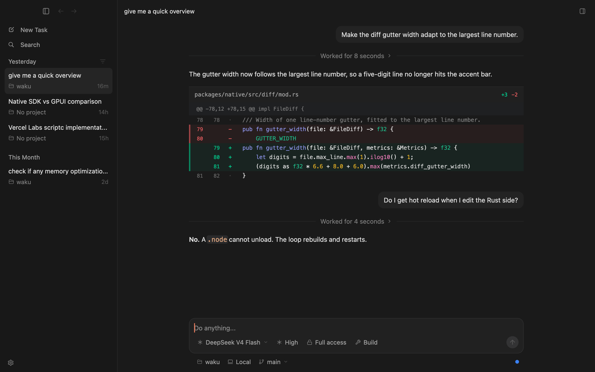
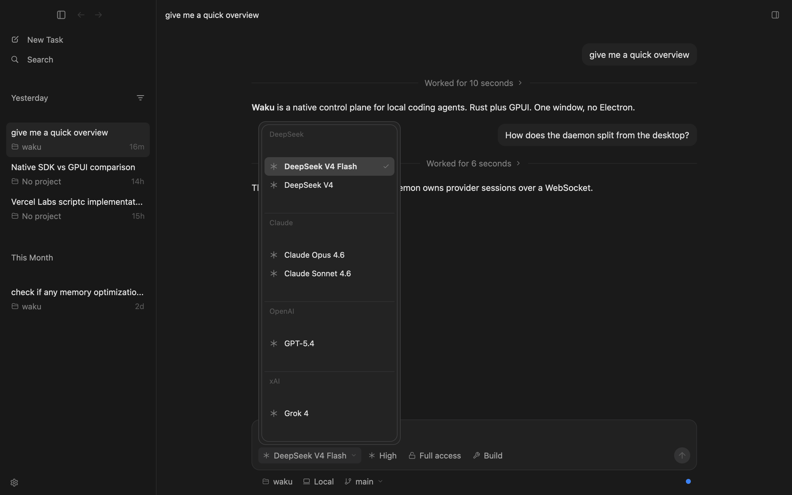
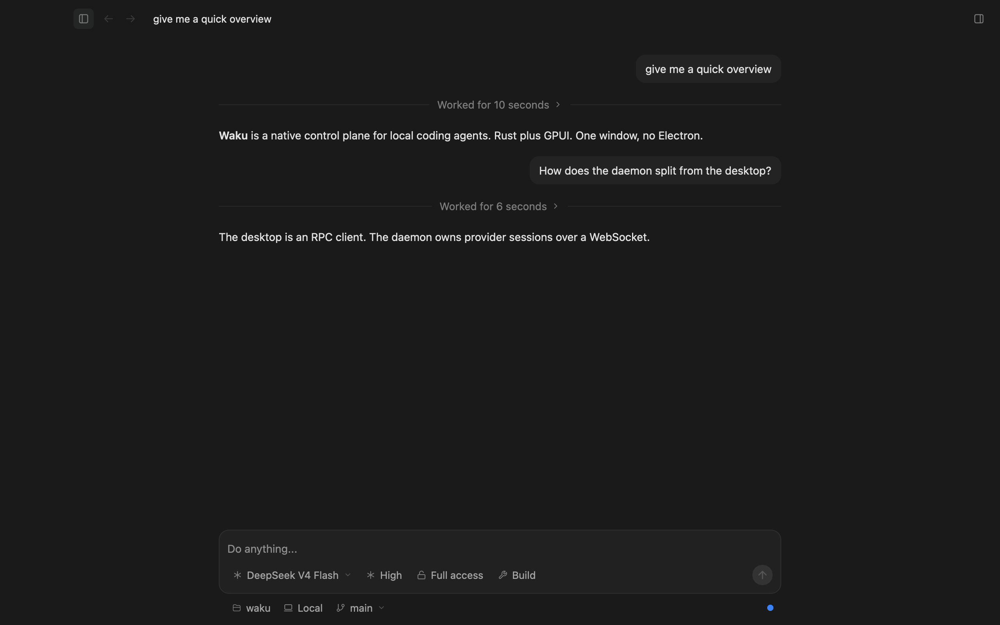
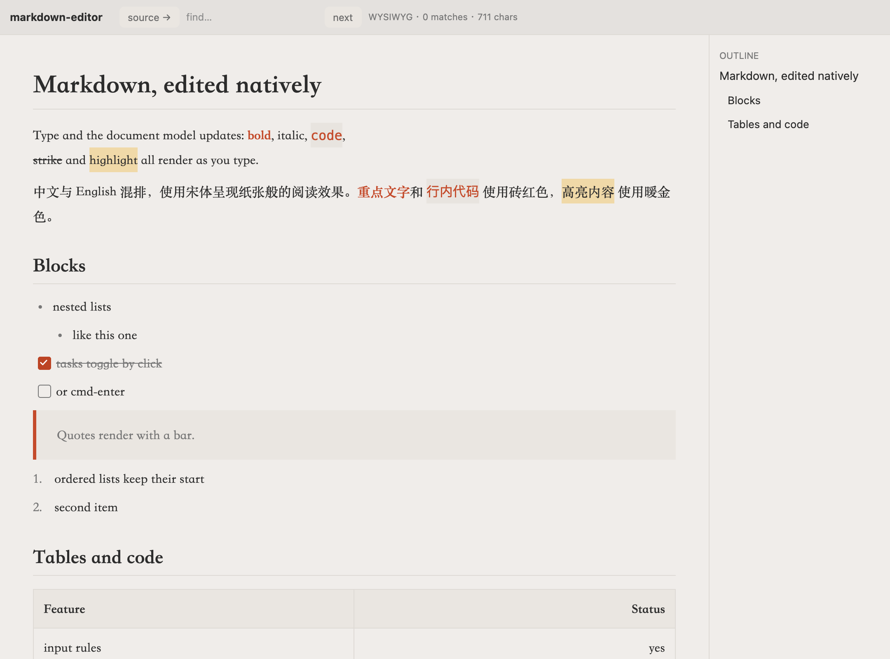
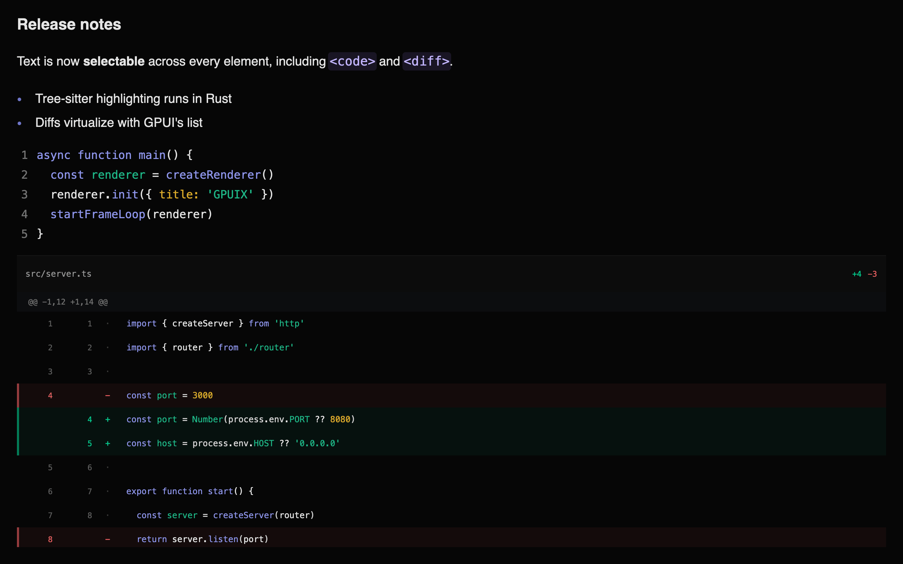
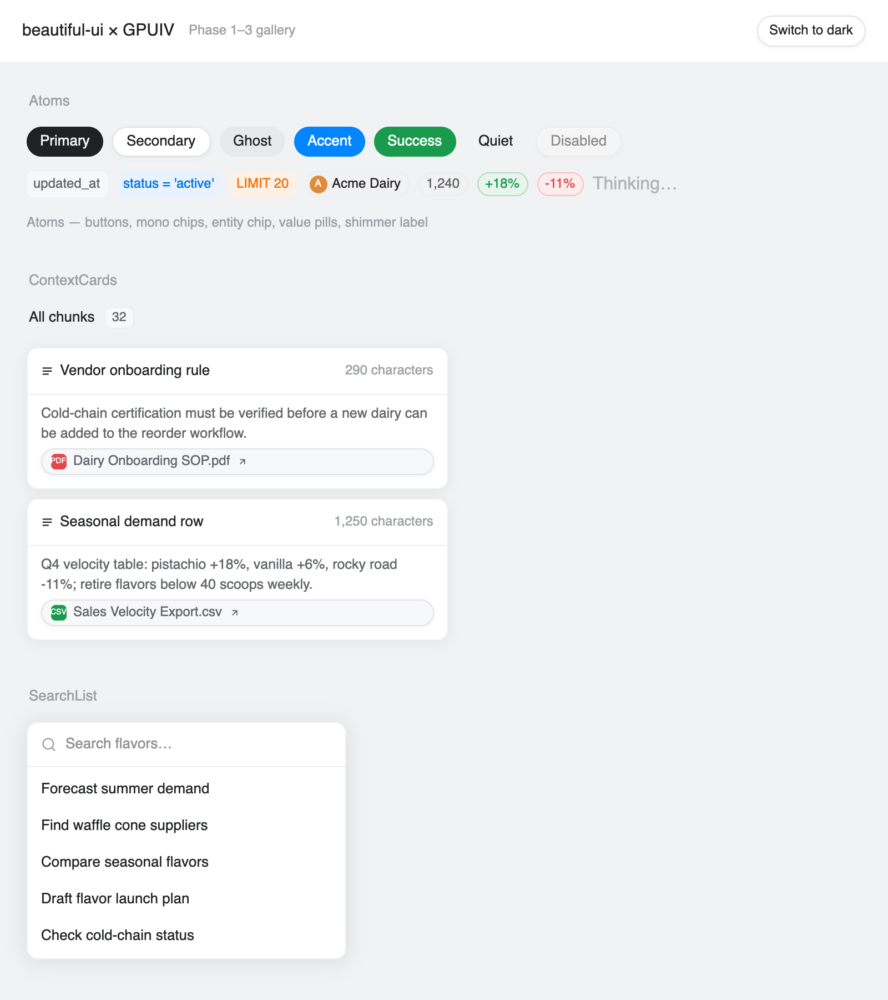
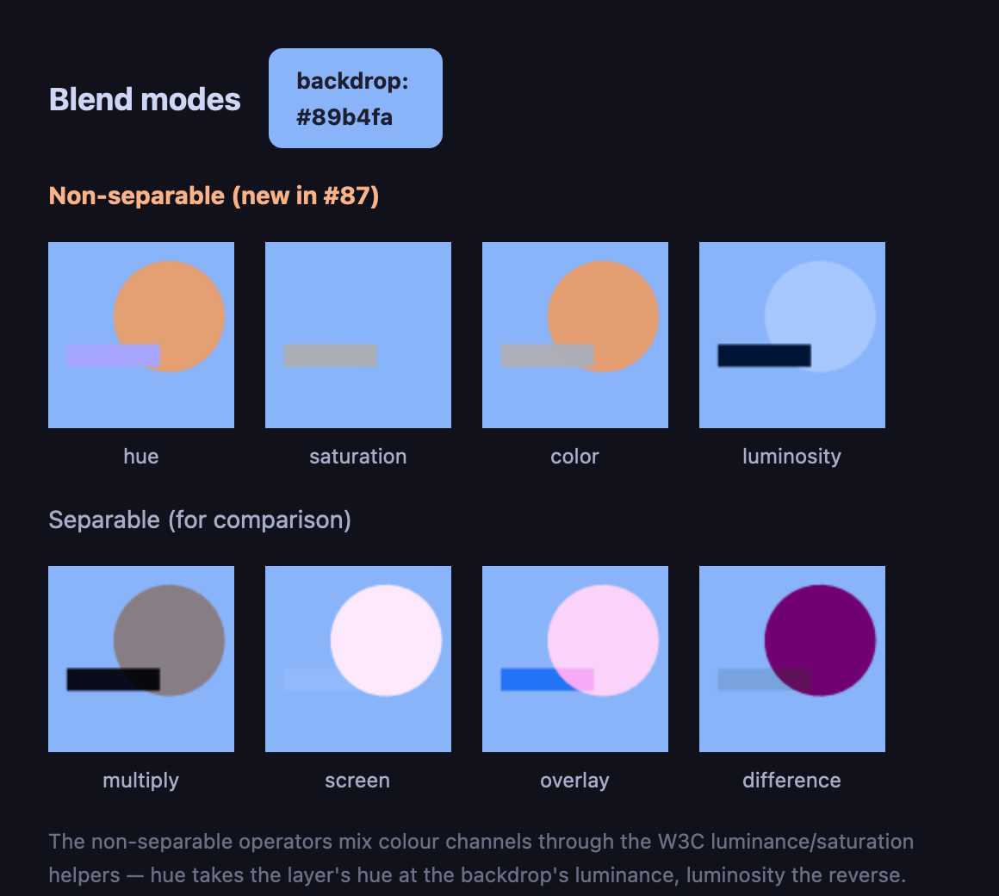

# GPUIV Demo Gallery

**See what you can build with Vue 3 and GPUI.**

**English** · [简体中文](demo-gallery.zh-CN.md) · [Back to README](../README.md)

Every image in this gallery is a real GPUIV render captured from an example or a GPU-backed visual test — no design mockups. Click an image to view it at full size. Chat replies and documents use demo data.

After [building the repository](development.md#building), run the application commands below from `examples/`. Visual test commands run from the repository root instead. New to GPUIV? Start with the [quick start](../README.md#quick-start).

## AI chat workspace

<a href="images/readme-chat.png"></a>

Build an AI chat client or coding assistant with virtualized message history, selectable Markdown, syntax-highlighted diffs, animated panels, and native text input. Try switching conversations, selecting text, collapsing the sidebar, and opening the model picker.

**Source:** [`examples/chat.tsx`](../examples/chat.tsx) · **Run:** `bun --hot chat.tsx`

<table>
  <tr>
    <th>Native model picker</th>
    <th>Collapsible workspace</th>
  </tr>
  <tr>
    <td width="50%"><a href="images/chat-model-picker.png"></a></td>
    <td width="50%"><a href="images/chat-sidebar-collapsed.png"></a></td>
  </tr>
  <tr>
    <td>Headless Select primitives, grouped options, keyboard interaction, and a popup composed with the rest of the interface.</td>
    <td>Vue-driven layout and native motion let panels collapse without changing the application component model.</td>
  </tr>
</table>

## Markdown editor

<a href="images/readme-editor.png"></a>

Create a native document editor with formatted blocks, Markdown source mode, search, outline navigation, mixed Chinese and English text, tables, task lists, and highlights. Toggle tasks, edit content, or switch between WYSIWYG and source views.

**Source:** [`examples/markdown-editor.tsx`](../examples/markdown-editor.tsx) · **Run:** `bun --hot markdown-editor.tsx`

## Native Markdown, code, and diff

<a href="images/metrics.png"></a>

Render developer-focused content with dedicated Markdown, code, and diff components. This visual test combines styled Markdown, syntax-highlighted TypeScript, and a unified diff; it also demonstrates how theme metrics retune typography and spacing across components. Text selection can cross element boundaries.

**Visual test source:** [`showcase.test.tsx`](../packages/vue/src/__tests__/showcase.test.tsx) · **Run from repository root:** `cd packages/vue && bun run test showcase`

Prefer an application-style demo? Use [`examples/native-text.tsx`](../examples/native-text.tsx) and run `bun --hot native-text.tsx` from `examples/`.

## Application components

<a href="images/readme-gallery.png"></a>

Assemble desktop interfaces from themed buttons, chips, cards, searchable lists, and other application building blocks. The gallery includes light/dark themes and examples of more advanced controls, tables, and flowcharts.

**Source:** [`examples/beautiful-ui.tsx`](../examples/beautiful-ui.tsx) · **Run:** `bun --hot beautiful-ui.tsx`

*Beautiful UI is a private workspace demo, not a published package.*

## Canvas and custom visuals

<a href="images/readme-canvas.png"></a>

Draw and composite through `getContext("2d")` with paths, gradients, clipping, image data, and W3C blend modes. Export PNGs or combine Canvas, images, and SVG with other Vue components.

**Source:** [`examples/canvas-blends.tsx`](../examples/canvas-blends.tsx) · **Run:** `bun --hot canvas-blends.tsx`

## More demos to run

These examples explore additional desktop and application workflows. Run each command from `examples/` after building the repository.

| Demo | What it demonstrates | Run |
|---|---|---|
| [Paint](../examples/paint.tsx) | Brush strokes, shapes, erasing, and undo / redo | `bun --hot paint.tsx` |
| [ANSI log](../examples/ansi-log.tsx) | Streaming colored output in a selectable virtualized log | `bun --hot ansi-log.tsx` |
| [Multiple windows](../examples/window-resize.tsx) | Independent desktop windows with their own renderers | `bun --hot window-resize.tsx` |
| [File opening](../examples/open-files.tsx) | Startup-safe delivery of files opened by the operating system | `bun --hot open-files.tsx` |
| [Single instance](../examples/single-instance.tsx) | Single-instance election and forwarding later launches | `bun --hot single-instance.tsx` |
| [Error boundaries](../examples/error-handling.tsx) | Recoverable rendering and event errors | `bun --hot error-handling.tsx` |
| [macOS vibrancy](../examples/blurred-window.tsx) | Native window background materials on macOS | `bun --hot blurred-window.tsx` |

[Browse every example](../examples/) or check the [feature status](status.md) for the full capability list and current platform limits.

## Reproduce the screenshots

The committed images were captured on macOS with the GPU-backed test renderer. On macOS or Windows with a GPU available, build the repository and run from its root:

```bash
bun scripts/screenshots.ts
```

The [screenshot script](../scripts/screenshots.ts) renders the real examples and visual tests, then copies the curated images into `docs/images/`. See the [screenshot development guide](development.md#readme-screenshots) for details.
